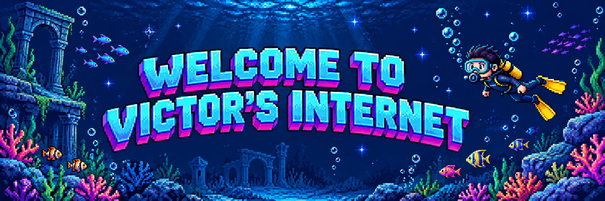
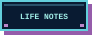

  

  <b>Oh, hello there. I'm Victor. 👋</b> 
  A full-stack developer in Shanghai, with roots in frontend. 🐠

  

  
  
  

  

I work mostly with React, TypeScript, Go, and Java, and enjoy bringing AI tools into everyday development.

<b>Code Clarity &gt; Code Brevity.</b> When something doesn't click, I read the source, build a small demo, and try to explain it in plain language. My blog is where I share what I learn along the way — from building software to figuring things out beyond the screen.

### A few things I've written

- [Building a desktop automation tool with Electron and Puppeteer](https://www.victoryeah.com/post/electron-workflow-automation/)
- [Learning Go concurrency through worker pools](https://www.victoryeah.com/post/go-worker-pool/)
- [Trying Matt Pocock's Skills in real workflows](https://www.victoryeah.com/post/matt-pocock-skills-v1-1/)
- [Back to my old school, ten years later](https://www.victoryeah.com/post/jincai-30th-anniversary/)

  
🫧 A little more, if you're curious

   
  
Away from the keyboard: traveling, playing basketball, cheering for Steph Curry, and listening to Taylor Swift.

  
And yes, that's me in the diving photo — Phuket, 2019. 🐠

  
<a href="https://www.victoryeah.com/about/">More about me →</a>

<!-- Layout inspired by github.com/sindresorhus; artwork and decorative assets were made for this profile. -->
